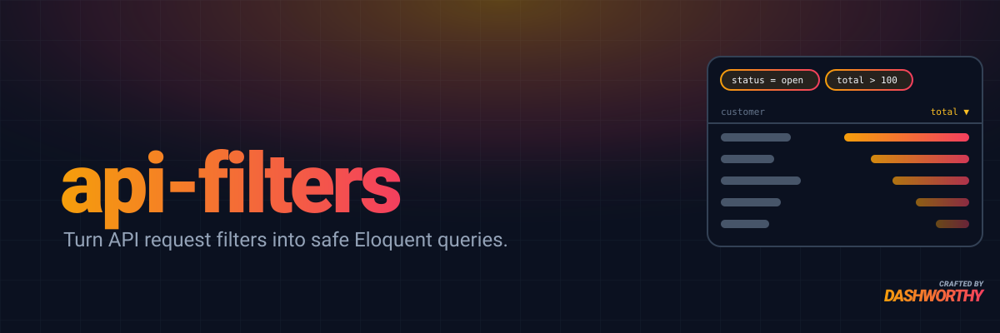

<p align="center">
    <a href="https://packagist.org/packages/dashworthy/api-filters"></a>
    <a href="https://packagist.org/packages/dashworthy/api-filters"></a>
    <a href="https://packagist.org/packages/dashworthy/api-filters"></a>
    <a href="https://github.com/dashworthy/api-filters/actions"></a>
    <a href="https://packagist.org/packages/dashworthy/api-filters"></a>
</p>

Apply API request filters and sorts to Eloquent queries without trusting client-supplied identifiers.

> [!IMPORTANT]
> 0.x is in early development. Filtering on a model's own columns works; relation filters, sorting and form requests arrive in the next 0.x releases. The API may change before 1.0.

## Installation

You can install the package via Composer:

```bash
composer require dashworthy/api-filters
```

You may publish all of the package's resources at once:

```bash
php artisan vendor:publish --tag="api-filters"
```

Or, you may publish each resource individually:

### Publishing the Configuration File

```bash
php artisan vendor:publish --tag="api-filters-config"
```

### Publishing the Translations

```bash
php artisan vendor:publish --tag="api-filters-lang"
```

## Usage

### Request format

A client sends filter sets, sorts and an optional result window:

```json
{
    "filter_sets": [
        {
            "filter_set_operator": "and",
            "filters": [
                { "field": "status", "value": "open", "filter_operator": "equals" },
                { "field": "total", "value": 100, "filter_operator": "gt" }
            ]
        }
    ],
    "sorts": [{ "field": "total", "sort_operator": "desc" }],
    "first": 0,
    "last": 50
}
```

The filters inside a set are joined by its `filter_set_operator`, `and` or `or`. Sets are always joined to each other with AND.

### Filtering a query

Apply a request's `filter_sets` to any Eloquent query:

```php
public function index(Request $request)
{
    return Order::query()
        ->where('team_id', $request->user()->team_id)
        ->apiFilters($request->input('filter_sets', []))
        ->get();
}
```

`ApiFilters::for($query)->filter($filterSets)->query()` does the same through a fluent object.

Filters never widen the constraints you apply first. Each filter set runs inside its own bracketed group, so an `or` set cannot return another team's rows. The whole input is validated before anything is applied, so a rejected request leaves the query as it was.

### Operators

These operators ship with the package. You can [add your own](#adding-your-own-operators).

| Operator | Matches | Value |
|---|---|---|
| `equals`, `doesNotEquals` | `=`, `!=` (`IS NULL`, `IS NOT NULL` for `null`). `doesNotEquals` leaves out NULL rows | a single value or `null` |
| `lt`, `lte`, `gt`, `gte` | `<`, `<=`, `>`, `>=` | a single value |
| `in`, `notIn` | `IN (…)`, `NOT IN (…)`. A `null` in the list matches NULL rows for `in`; NULL rows never match `notIn` | a non-empty list |
| `startsWith`, `contains`, `endsWith`, `doesNotContain` | `LIKE` in any letter case. `doesNotContain` also matches NULL rows. A `%` or `_` in the value is a wildcard | a string or number |
| `dateIs`, `dateIsNot`, `dateBefore`, `dateAfter` | the date part of the column, at any time of day | `YYYY-MM-DD` |

The strings `true` and `on`, `false` and `off`, and `null` are read as `true`, `false` and `null`, element by element in a list. Every other string, numeric ones included, is compared as sent, so `"007"` never matches `7`. The `normalizers` key in `config/api-filters.php` lists the classes that do this. Each implements `Dashworthy\ApiFilters\Contracts\NormalizerContract` and hands its result to `$next`; an empty list switches them off.

### Adding your own operators

An operator is a class that implements `Dashworthy\ApiFilters\Contracts\FilterOperationContract`:

| Method | Job |
|---|---|
| `canHandle(FilterData $filterData)` | Says whether it applies this filter, usually by its `operator` |
| `rules()` | Returns the Laravel validation rules the value must pass |
| `handle(Builder $query, FilterData $filterData)` | Adds the filter's condition to `$query` |

List the class under `operations` in `config/api-filters.php`. Every class whose `canHandle()` accepts a filter checks the value against its `rules()`, then adds its condition, so two classes that handle the same operator both apply. An operator that no class handles gets a 422. To replace a built-in operator, take its class out of the list and add yours.

Operations write their SQL with Laravel's query builder, which writes it for each database: `whereLike()` matches in any letter case and `whereDate()` compares calendar dates wherever they run. Where an operator needs different SQL on your database, replace its class.

This operation keeps the rows whose point column lies inside a polygon:

```php
use Closure;
use Dashworthy\ApiFilters\Contracts\FilterOperationContract;
use Dashworthy\ApiFilters\Data\FilterData;
use Illuminate\Database\Eloquent\Builder;

class WithinPolygon implements FilterOperationContract
{
    public function canHandle(FilterData $filterData): bool
    {
        return $filterData->operator === 'withinPolygon';
    }

    /**
     * A closed ring of up to 1000 [longitude, latitude] positions.
     */
    public function rules(): array
    {
        return [
            'bail',
            'required',
            'list',
            'min:4',
            'max:1000',
            function (string $attribute, array $ring, Closure $fail): void {
                $isPosition = fn (mixed $position): bool => is_array($position) && array_is_list($position)
                    && count($position) === 2 && is_numeric($position[0]) && is_numeric($position[1]);

                if (array_filter($ring, $isPosition) !== $ring || $ring[0] != $ring[array_key_last($ring)]) {
                    $fail('The :attribute must be a closed ring of [longitude, latitude] positions.');
                }
            },
        ];
    }

    public function handle(Builder $query, FilterData $filterData): Builder
    {
        $ring = array_map(fn (array $position): array => array_map(floatval(...), $position), $filterData->value);
        $polygon = json_encode(['type' => 'Polygon', 'coordinates' => [$ring]], JSON_THROW_ON_ERROR);
        $column = $query->getQuery()->getGrammar()->wrap($filterData->column);

        return $query->whereRaw("ST_Contains(ST_GeomFromGeoJSON(?), {$column})", [$polygon]);
    }
}
```

```php
'operations' => [
    // ...the built-in operations
    WithinPolygon::class,
],
```

A client can then send `{ "field": "location", "filter_operator": "withinPolygon", "value": [[0, 0], [2, 0], [2, 2], [0, 2], [0, 0]] }`.

The package does the risky parts before `handle()` runs:

- `$filterData->column` is a visible column of the model, already checked and qualified with its table.
- The value has passed `rules()`. `scalarValue()`, `stringValue()` and `listValue()` read it back with a type.
- The condition lands in a group of the filter's own, joined to its set by the set's `and` or `or`, inside the set's group. Even an `orWhere()` in it cannot widen the constraints you applied first.

The rest is up to you. Bind every value, as the `?` in `whereRaw()` does above, and wrap the column with the grammar. Never write client input into SQL. Cap the size of a value in `rules()`, as `max:1000` does here, so one request cannot make the database do unbounded work.

### What a client can and cannot reach

- **Columns.** A field must be a real column of the model's table, matched in any letter case, that the model does not hide (`$hidden`, or missing from a non-empty `$visible`). Fields such as `password` and `remember_token` cannot be filtered.
- **Every visible column is filterable.** `$hidden` and `$visible` are the boundary. A column you forget to hide can be probed one character at a time, for example with `password startsWith $2y$10$a`, so hide anything a client must not search.
- **Relations.** A dotted field such as `customer.name` is rejected. Clients never choose which method is called on your model.
- **Mistakes.** An unknown operator, a bad value or a field that cannot be used returns a 422 validation error keyed by its input path, for example `filter_sets.0.filters.1.field`. An unknown column and a hidden one get the same message.

### Limits

Every limit can be changed in `config/api-filters.php`:

| Limit | Key | Default |
|---|---|---|
| Filter sets per request | `limits.filter_sets` | 10 |
| Filters across all sets | `limits.filters` | 50 |
| Values in one `in` or `notIn` list | `limits.in_values` | 100 |

### Planned

> [!NOTE]
> Not available yet. The next 0.x releases are designed to ship these, and they may change before 1.0.

- **Relation filters.** A dotted field such as `customer.name` will work once the query allow-lists `customer`: `->apiFilters($filterSets, allowedRelations: ['customer'])`. Adds `doesntHave`, which matches rows with no related row.
- **Sorting.** `sorts[]{field, sort_operator}` with `asc`, `desc` or `none`, through `->apiSorts($sorts, allowedRelations: ['customer'])`. Only to-one relations can be sorted on. Up to 5 sorts.
- **Form requests.** Extend `FilterableRequest`, which validates `filter_sets`, `sorts`, `first` and `last`, and declare `allowedRelations()`. Then `->apiFiltersAndSorts($request)` applies the filters, then the sorts, then the `first`/`last` window of up to 1000 rows.

```php
use Dashworthy\ApiFilters\Http\FilterableRequest;

class ListOrdersRequest extends FilterableRequest
{
    public function allowedRelations(): array
    {
        return ['customer', 'lineItems.product'];
    }
}
```

## Testing

The suite runs on MariaDB. Start one, then run every check:

```bash
docker run -d -p 3306:3306 -e MARIADB_ALLOW_EMPTY_ROOT_PASSWORD=1 -e MARIADB_DATABASE=api_filters mariadb:11.4
composer test
```

`DB_HOST`, `DB_PORT`, `DB_DATABASE`, `DB_USERNAME` and `DB_PASSWORD` override the defaults in `phpunit.xml.dist`.

## Changelog

Please see [CHANGELOG](CHANGELOG.md) for more information on what has changed recently.

## Contributing

Thank you for considering contributing to API Filters! Please review our [contributing guide](https://github.com/dashworthy/api-filters/blob/HEAD/.github/CONTRIBUTING.md) to get started.

## Security Vulnerabilities

Please review [our security policy](https://github.com/dashworthy/api-filters/security/policy) on how to report security vulnerabilities.

## Credits

- [Andrew Leach](https://github.com/dashworthy)
- [All Contributors](../../contributors)

## License

API Filters is open-sourced software licensed under the [MIT license](LICENSE.md).
